<h1 align="center">Parking Space Reservation Chatbot</h1>

<p align="center">
  An AI assistant for a parking facility. It answers questions, checks live prices and
  availability, collects reservation details, protects sensitive data, sends every booking to
  a human administrator for approval, and records approved bookings through an MCP server.
  Built with Python, LangChain and LangGraph on a Retrieval-Augmented Generation (RAG)
  architecture.
</p>

<p align="center">
  <a href="https://github.com/likhithe2204/parking-chatbot/actions/workflows/ci.yml">
    
  </a>
  
  
  
</p>

---

## Table of Contents

1. [Overview](#overview)
2. [Architecture](#architecture)
3. [How It Works](#how-it-works)
4. [Stage 1 Demo](#stage-1-demo)
5. [Stage 2: Human-in-the-Loop Administrator](#stage-2-human-in-the-loop-administrator)
6. [Stage 3: MCP Server](#stage-3-mcp-server)
7. [Setup](#setup)
8. [Usage](#usage)
9. [Evaluation](#evaluation)
10. [Testing and CI](#testing-and-ci)
11. [Security](#security)
12. [Project Structure](#project-structure)
13. [Roadmap](#roadmap)

---

## Overview

This repository covers **Stage 1** (RAG chatbot, guardrails, evaluation), **Stage 2**
(human-in-the-loop administrator approval) and **Stage 3** (MCP server that records approved
reservations). Each stage is tagged in Git: `stage-1`, `stage-2`, `stage-3`.

**Presentations:** [Stage 1](docs/parking_chatbot_stage1.pptx),
[Stage 2](docs/parking_chatbot_stage2.pptx) and [Stage 3](docs/parking_chatbot_stage3.pptx)

**Features**

1. Answers questions about the facility: general information, location, zones, EV charging, booking process.
2. Reports live data: working hours, prices and free spaces.
3. Collects reservation details one field at a time and validates each answer.
4. Masks sensitive data (email, phone, card number) and blocks prompt injection.
5. Sends each reservation to a human administrator, who approves or refuses it.
6. Lets the customer ask for the decision at any time.
7. Writes every approved booking to a text file through a secured MCP server.
8. Ships with an evaluation report: Recall@K, Precision@K, MRR and latency.

**Tech stack**

| Area | Choice |
|---|---|
| Language | Python 3.12 |
| Agent framework | LangChain, LangGraph |
| LLM | GPT via EPAM DIAL (Azure OpenAI interface) |
| Vector database | Chroma |
| Embeddings | `all-MiniLM-L6-v2` (sentence-transformers) |
| Dynamic data | SQLite |
| Admin service | FastAPI, httpx |
| MCP server | MCP Python SDK (`mcp<2`) mounted in FastAPI |
| Guardrails | Microsoft Presidio and spaCy |
| Testing | pytest, GitHub Actions |

---

## Architecture

<p align="center">
  
</p>

---

## How It Works

**1. Static data goes to the vector database.**
General information, zones, location and the booking process are split into chunks,
embedded and stored in Chroma. A question about the facility retrieves the 3 closest chunks.

**2. Dynamic data goes to SQL.**
Working hours, prices and availability change often, so they live in SQLite and are read
through parameterized, read-only queries.

**3. The agent chooses the right tool.**
The agent reads each question and decides whether to search the vector database, query SQL,
or start the reservation flow.

**4. Reservations are collected and validated field by field.**
Each detail is saved in a draft the moment the customer gives it: names contain letters only,
car numbers look like `TS09AB1234`, dates are in the future, and the end comes after the start.
The code accepts a detail only if it appears in the customer's own message, so the model cannot
invent values.

**5. Every booking goes to a human.**
After the customer confirms, the booking is handed to the admin agent (Stage 2). The bot never
says a booking is confirmed until the administrator has decided.

**6. Approved bookings are written by an MCP server.**
When the administrator approves, the booking is sent to the MCP server (Stage 3), which appends
one line to a text file.

**7. Guardrails protect both directions.**
The input guardrail masks sensitive data and blocks prompt injection. The output guardrail
masks anything sensitive that slips into a reply.

---

## Stage 1 Demo

### 1. Vector database ingestion and retrieval check

<p align="center">
  
</p>

---

### 2. Answering information, price and availability questions

<p align="center">
  
</p>

---

### 3. Reservation flow with validation

<p align="center">
  
</p>

---

### 4. Guardrails for sensitive data

<p align="center">
  
</p>

---

### 5. Evaluation report

<p align="center">
  
</p>

---

### 6. Automated tests and CI

<p align="center">
  
</p>

<p align="center">
  
</p>

---

## Stage 2: Human-in-the-Loop Administrator

After the customer confirms a booking, the chatbot hands it to a second agent. The admin agent
writes a short note for the administrator and sends the request to a small REST service. A human
administrator approves or refuses it in a terminal console. The customer can ask for the status
at any time.

<p align="center">
  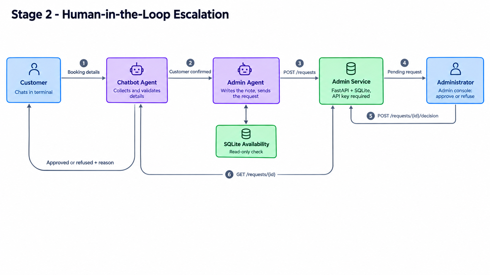
</p>

**Design points**

1. Every reservation detail must come from the customer's own words. The code rejects values the
   model made up, and a reply guard stops summaries that do not match the saved details.
2. The admin agent only writes the note. Customer details are attached by code, and the decision
   text is produced by code, so a refusal can never be worded as an approval.
3. If the model fails, the request is still sent with a default note. If the admin service is
   down, the customer is told the request was not sent.
4. The admin service requires an API key, validates every request again, and accepts only one
   decision per request.

Changes since Stage 1: [stage-1...stage-2](https://github.com/likhithe2204/parking-chatbot/compare/stage-1...stage-2)

---

### 1. Admin service API

<p align="center">
  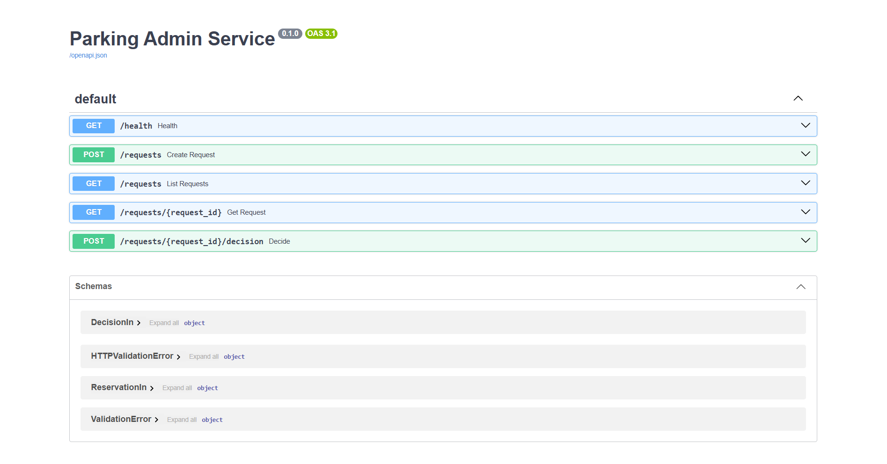
</p>

---

### 2. Administrator console

<p align="center">
  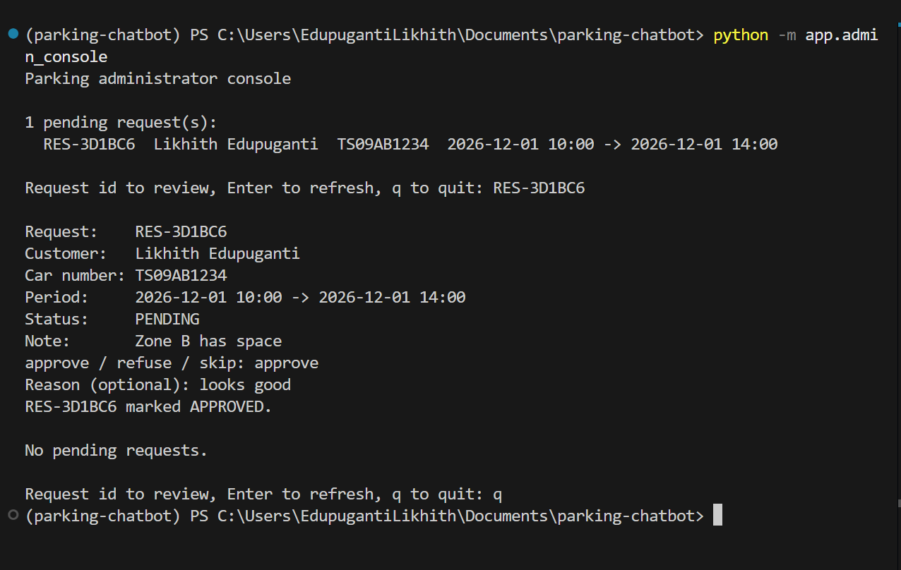
</p>

---

### 3. Admin agent

<p align="center">
  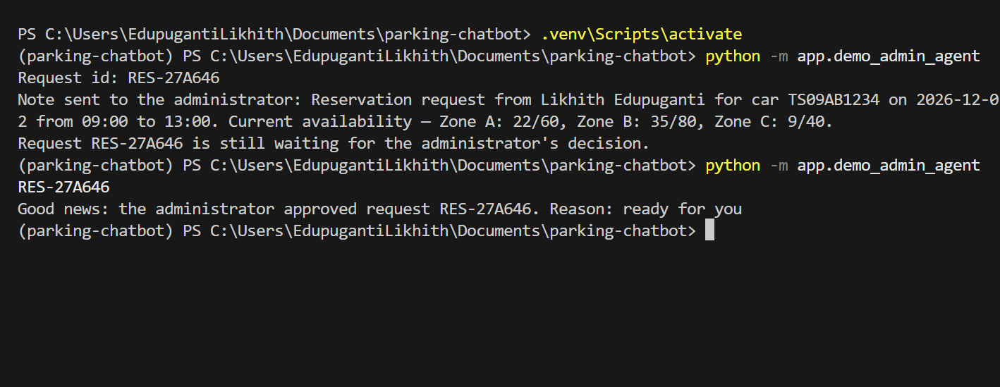
</p>

---

### 4. End to end: request, pending, approved

<p align="center">
  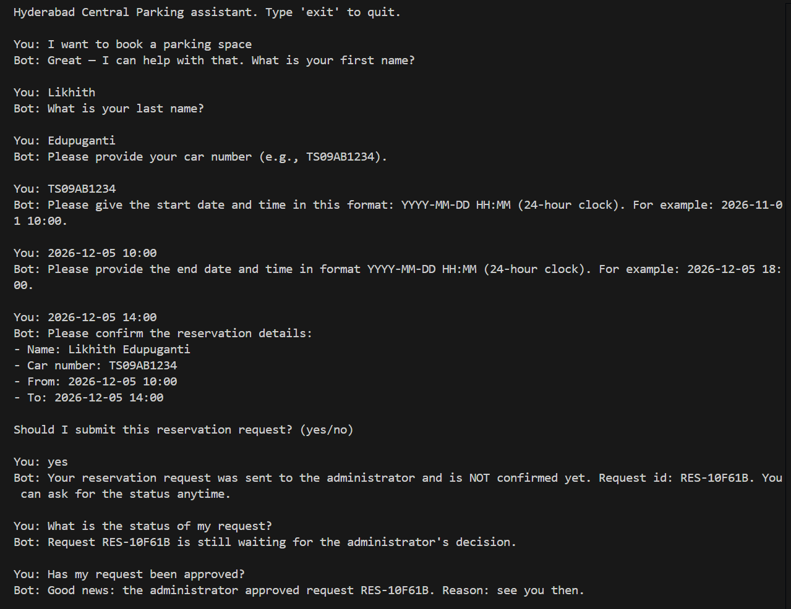
</p>

---

### 5. End to end: refused

<p align="center">
  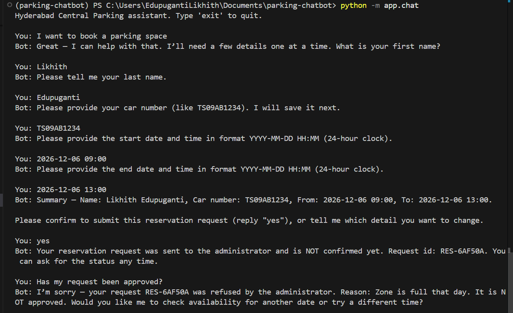
</p>

---

### 6. Tests and CI

<p align="center">
  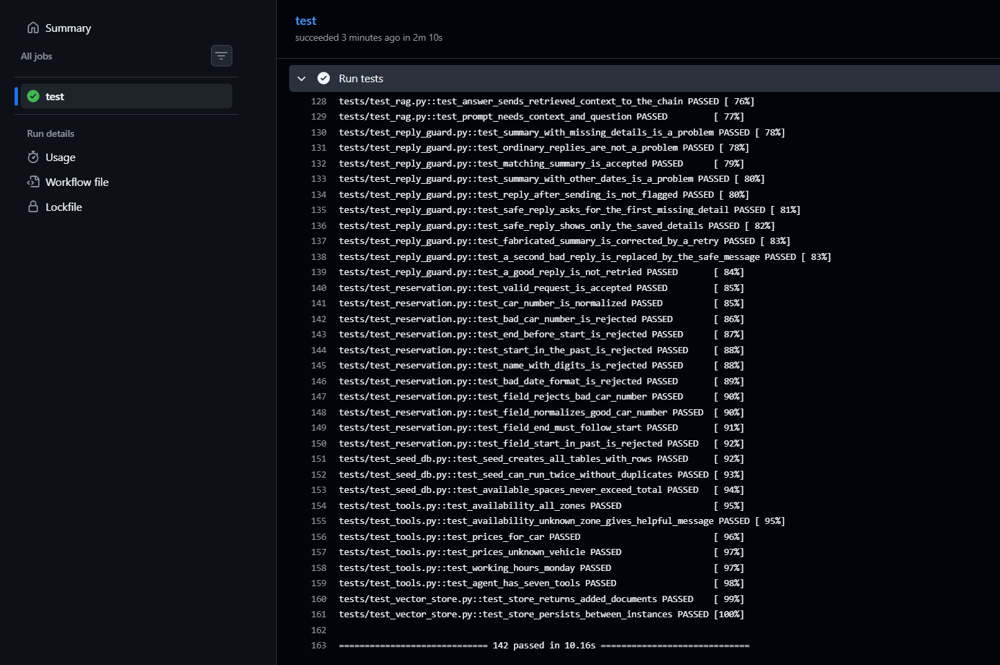
</p>

<p align="center">
  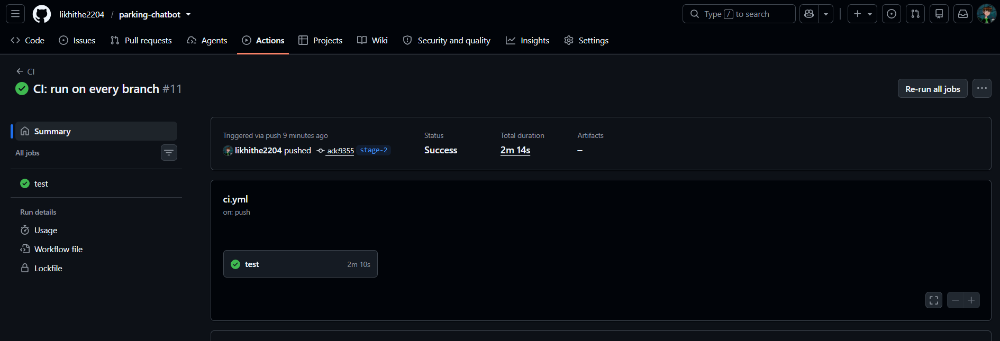
</p>

---

## Stage 3: MCP Server

Once the administrator approves a booking, the admin side calls an MCP server. The server checks
the API key and every field, then appends one line to a text file in this format:

```text
Name | Car Number | Reservation Period | Approval Time
Likhith Edupuganti | TS09AB1234 | 2026-12-08 10:00 to 2026-12-08 14:00 | 2026-10-29 16:13:45
```

<p align="center">
  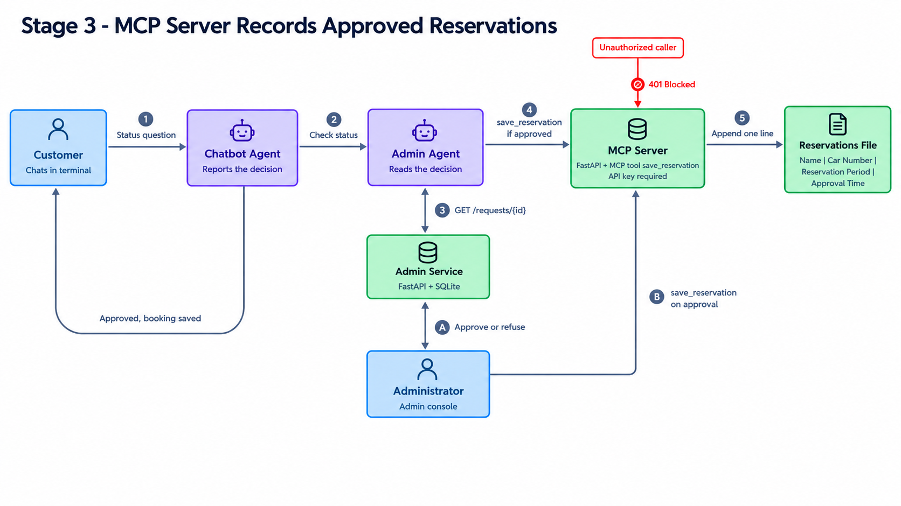
</p>

**Design points**

1. The server is Python: an MCP tool (`save_reservation`) built with the MCP SDK and mounted in a
   FastAPI app that also serves `/health`. It exposes one tool only.
2. Code decides, not the model. Approving in the console saves the booking at once. Typing `s` in
   the console retries any approved booking that was not saved. A customer's status check saves
   it too, as a safety net. The language model never decides whether a record is written.
3. Security: every route except `/health` needs the API key (checked in constant time), every
   field is validated again, names cannot contain the separator or line breaks, and the
   reservations file is excluded from Git.
4. Reliability: writes are locked, flushed to disk and appended, the same booking is never written
   twice, and the client has a timeout and reports failures instead of hiding them.

**Run it** (four terminals, environment active in each)

```bash
uvicorn app.admin_api:create_app --factory --port 8000   # 1: admin service
uvicorn app.mcp_server:create_app --factory --port 8001  # 2: MCP server
python -m app.chat                                       # 3: customer chat
python -m app.admin_console                              # 4: administrator
```

Changes since Stage 2: [stage-2...stage-3](https://github.com/likhithe2204/parking-chatbot/compare/stage-2...stage-3)

---

### 1. Security checks

<p align="center">
  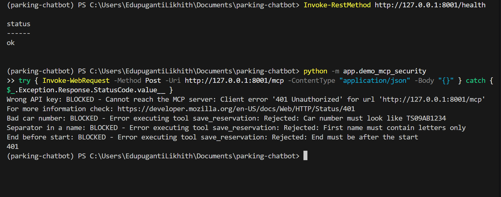
</p>

---

### 2. Approval saves the booking

<p align="center">
  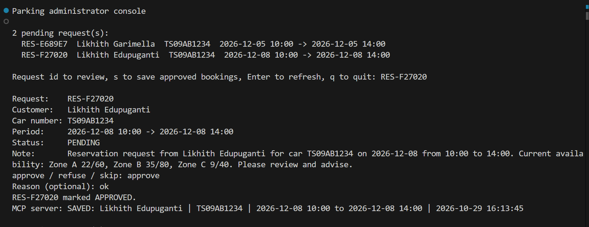
</p>

---

### 3. End to end: approved and saved

<p align="center">
  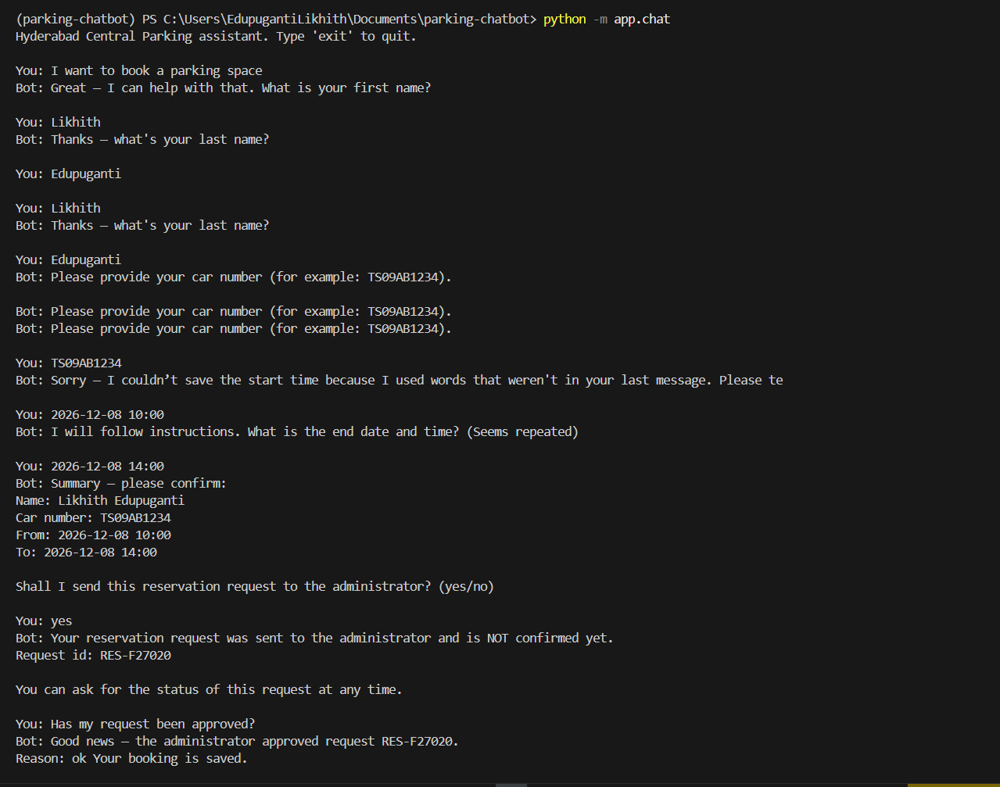
</p>

---

### 4. The reservations file

<p align="center">
  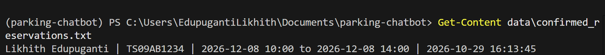
</p>

---

### 5. Tests and CI

<p align="center">
  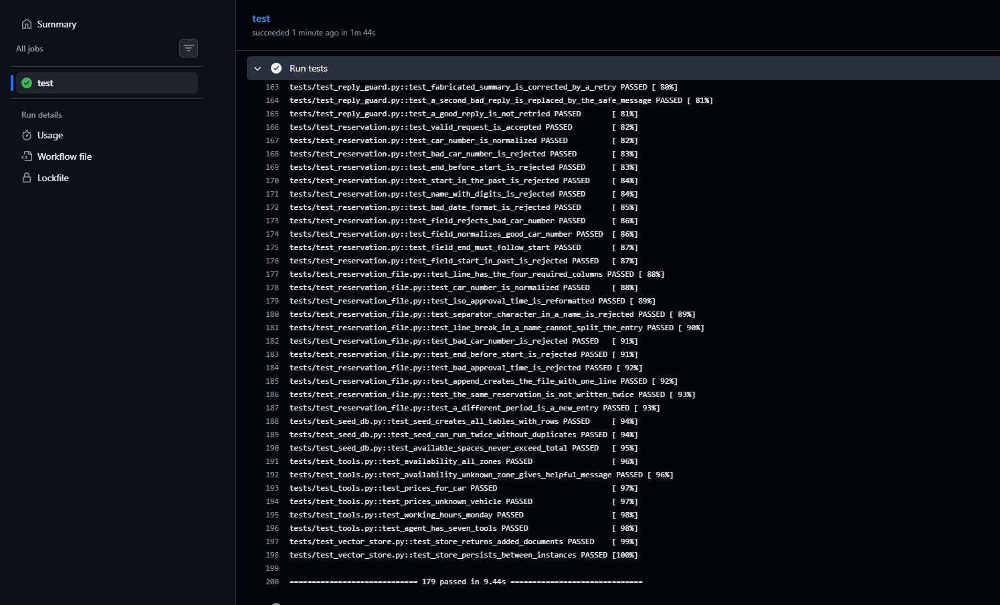
</p>

<p align="center">
  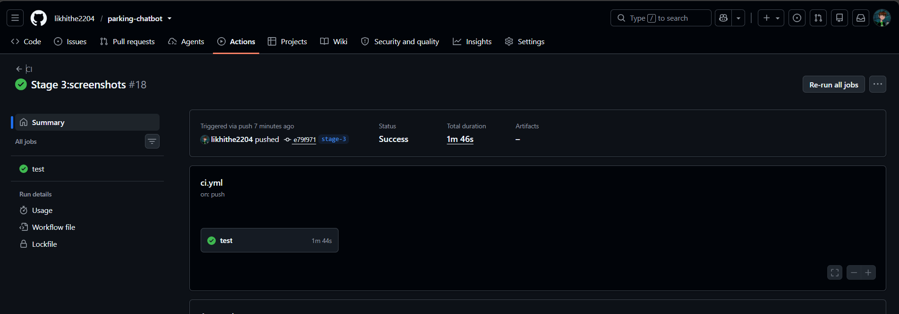
</p>

---

## Setup

**Requirements:** Python 3.12, [uv](https://docs.astral.sh/uv/), and an EPAM DIAL API key
(the VPN is needed to call the model).

**1. Clone and create the environment**

```bash
git clone https://github.com/likhithe2204/parking-chatbot.git
cd parking-chatbot

uv venv
# Windows
.venv\Scripts\activate
# Mac/Linux
source .venv/bin/activate

uv pip install -r requirements.txt
```

**2. Add your keys**

```bash
# Windows
copy .env.example .env
# Mac/Linux
cp .env.example .env
```

Open `.env` and paste your DIAL API key. Set `ADMIN_API_KEY` and `MCP_API_KEY` to long random
strings. Generate each with:

```bash
python -c "import secrets; print(secrets.token_urlsafe(24))"
```

**3. Build the data stores**

```bash
python -m app.seed_db   # creates data/parking.db (dynamic data)
python -m app.ingest    # fills the Chroma vector database (static data)
```

---

## Usage

**Customer chat** (needs the admin service and the MCP server running in other terminals):

```bash
uvicorn app.admin_api:create_app --factory --port 8000
uvicorn app.mcp_server:create_app --factory --port 8001
python -m app.chat
```

**Example conversation**

| You | The bot |
|---|---|
| Where is the parking located? | Gives the address and the nearest metro |
| How much does it cost for a car? | Reads prices from SQL |
| Are there free spaces in Zone C? | Reads live availability from SQL |
| I want to book a parking space | Collects the details, then sends the request to the administrator |
| What is the status of my request? | Reports pending, approved or refused, with the reason |

**Administrator**

```bash
python -m app.admin_console
```

Pick a request id, then type `approve` or `refuse` and an optional reason. An approval is saved
to `data/confirmed_reservations.txt` through the MCP server. Type `s` to save any approved
booking that was not saved yet.

**Other commands**

| Command | Purpose |
|---|---|
| `python -m app.check_retrieval` | Quick retrieval check |
| `python -m app.demo_guardrails` | Shows the guardrails in action |
| `python -m app.demo_admin_agent` | Sends a sample request through the admin agent |
| `python -m app.demo_mcp_security` | Shows the MCP server blocking bad requests |
| `python -m app.evaluate` | Full evaluation, writes `docs/evaluation_report.md` |
| `python -m app.evaluate --skip-llm` | Evaluation without LLM calls |
| `python scripts/build_deck.py` | Rebuilds the Stage 1 presentation |
| `python scripts/build_deck_stage2.py` | Rebuilds the Stage 2 presentation |
| `python scripts/build_deck_stage3.py` | Rebuilds the Stage 3 presentation |
| `python -m pytest -v` | Runs all tests |

---

## Evaluation

Full report: [docs/evaluation_report.md](docs/evaluation_report.md)

**Retrieval quality** (13 questions)

| K | Precision@K | Recall@K |
|---|---|---|
| 1 | 0.92 | 0.85 |
| 2 | 0.62 | 0.92 |
| 3 | 0.44 | 1.00 |

MRR: **0.95**

**End-to-end answer accuracy:** 16 of 16 runs passed.

**Latency**

| Component | Mean |
|---|---|
| Retrieval (embedding and Chroma) | 8.1 ms |
| Input guardrail (Presidio) | 2.7 ms |
| SQL lookup tools | 0.2 ms |
| Full chatbot reply | about 6.2 s |

Almost all of the full reply time is the LLM call. Precision counts chunks and Recall counts
source documents, so with only a few chunks per document, Precision@3 is naturally lower
than Recall@3.

---

## Testing and CI

179 pytest tests cover SQL lookups, reservation validation, the reservation draft and reply
guard, tools, guardrails, the evaluation metrics, the admin store, API, client, console and
agent, and the reservation file writer, MCP server and MCP client. GitHub Actions runs them on
every push (`.github/workflows/ci.yml`). The tests never call the LLM, so they need no API key.

Every core module in `app/` has at least 2 tests. The demo scripts (`smoke_test`,
`check_retrieval`, `demo_guardrails`, `demo_admin_agent`, `demo_mcp_security`) are excluded
because they only print results.

```bash
python -m pytest -v
```

---

## Security

1. SQL queries are parameterized and the database is opened read-only.
2. Sensitive data is masked in user input and in model output.
3. Prompt injection phrases are blocked before they reach the model.
4. The system prompt forbids sharing staff or customer details.
5. API keys live in `.env`, which is excluded from Git. `.env.example` shows the format.
6. The admin service requires an API key and accepts one decision per request.
7. Reservation details must come from the customer's own words, so the model cannot invent them.
8. The MCP server needs the API key on every route except `/health`, exposes one tool, validates
   every field, and rejects separators and line breaks in names.
9. The reservations file holds customer data, so it is excluded from Git.
10. Both servers listen on `127.0.0.1` by default. Do not expose them to a network without TLS.

`data/static/internal_staff_notes.md` contains fake staff and customer details on purpose,
to demonstrate that the guardrails stop private data from leaking.

---

## Project Structure

```text
parking-chatbot/
  app/
    config.py            paths and chunking settings
    llm.py               DIAL / Azure OpenAI model loader
    vector_store.py      Chroma and embeddings
    ingest.py            loads, chunks and stores static data
    rag.py               retrieval and RAG answer chain
    seed_db.py           creates the SQLite database
    dynamic_data.py      read-only SQL lookups
    reservation.py       reservation validation
    draft.py             reservation draft, customer-words checks, reply guard
    tools.py             agent tools
    guardrails.py        input and output protection
    agent.py             chatbot agent, prompt and chat function
    chat.py              interactive chat loop
    admin_store.py       reservation requests and decisions (SQLite)
    admin_api.py         admin REST service (FastAPI)
    admin_client.py      REST client used by the agent and the console
    admin_agent.py       second agent: note, send, read decision, save approved booking
    admin_console.py     terminal for the human administrator
    reservation_file.py  validates and appends reservation lines
    mcp_server.py        MCP server with API key protection (FastAPI)
    mcp_client.py        client that calls the MCP server
    evaluation.py        metric functions
    evaluate.py          evaluation runner and report writer
  data/
    static/              knowledge base (markdown files)
    eval/                evaluation questions
  docs/
    screenshots/         architecture diagrams and proof screenshots
    evaluation_report.md
  scripts/               presentation builders
  tests/                 pytest tests
  .github/workflows/     CI pipeline
```

`data/confirmed_reservations.txt` is created at runtime and is not stored in Git.

---

## Roadmap

| Stage | Scope | Status |
|---|---|---|
| 1 | RAG chatbot, vector database, guardrails, evaluation | Done |
| 2 | Human-in-the-loop administrator agent | Done |
| 3 | MCP server that records approved reservations | Done |
| 4 | Full orchestration with LangGraph | Planned |